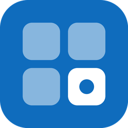
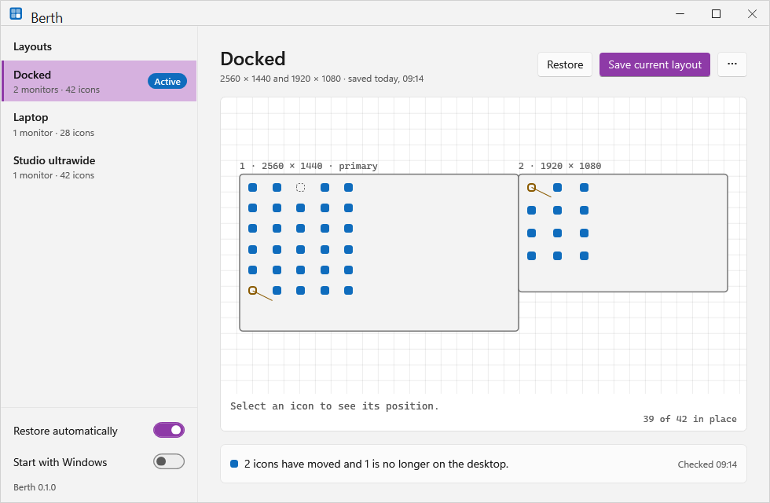
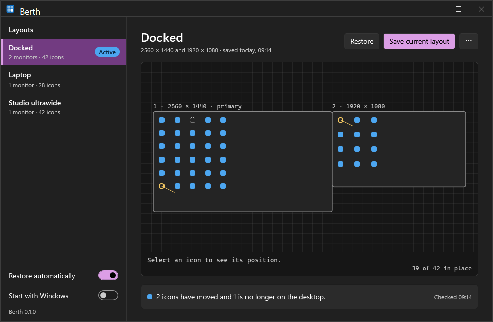

<div align="center">



# Berth

**Your desktop, where you left it. Berth saves the positions of your Windows desktop icons and puts them back.**

[](https://github.com/rizonesoft/Berth/actions/workflows/build.yml) [](https://github.com/rizonesoft/Berth/actions/workflows/plan.yml)
[](LICENSE)


[What it does](#what-does-berth-do) · [What works](#what-works-today) · [Install](#how-do-i-install-it) · [Use](#how-do-i-use-it) · [Limits](#what-does-it-not-do) · [Remove](#how-do-i-remove-it) · [Design](#what-does-it-look-like) · [Contributing](CONTRIBUTING.md) · [Security](SECURITY.md)



<sub>Built Berth client rendered in the light theme with sample data (3 layouts, 42 icons, 2 monitors; framed capture).</sub>

</div>

## What does Berth do?

Windows forgets where your desktop icons were. Change the resolution, dock or undock a laptop, connect over Remote Desktop or restart Explorer, and the layout you arranged is scrambled. A berth is a ship's allotted place: Berth gives every icon one, and returns it there.

- **Saves every icon's position** to a small JSON layout file.
- **Keeps a layout per monitor arrangement**, so a docked setup and a laptop on its own each have their own.
- **Puts icons back** on demand, or automatically when the monitor arrangement changes or Explorer restarts.
- **Shows you the layout**: a map of each monitor with every saved position, which icons are in place, which moved and which are missing.
- **One file, no installer**: no administrator rights, no network use, no telemetry.

## What works today?

| Part | What it does |
| ---- | ------------ |
| Tray app | Single-instance tray icon (dark/light variants), context menu, failure balloon, Explorer recovery |
| Main window | Layout list, monitor map with icon readout, Save/Restore/Undo/Revert/Rename/Delete, light/dark/HC |
| Auto restore | When turned on, restores the active layout 3 seconds after display changes or Explorer restarts |
| Command line | `save`, `restore`, `undo`, `list`, `--version`, `--help` with documented output and exit codes |
| Single-file | Self-contained `win-x64` `berth.exe` with embedded manifest, icon and SHA-256 checksum sidecar |

## How do I install it?

Berth is a single `berth.exe` file with no installer.

- **Before the first tagged GitHub release (build from source):** clone the repository on Windows 11 x64 with PowerShell 7 and the .NET 11 SDK installed, then run `pwsh scripts/publish.ps1`. Copy `artifacts\berth.exe` (and `artifacts\berth.exe.sha256`) to any folder you like.
- **Once a GitHub release is published:** download both `berth.exe` and `berth.exe.sha256` from the same release on the [Releases page](https://github.com/rizonesoft/Berth/releases) into one folder.

Before running a downloaded binary, verify that its SHA-256 digest matches the `.sha256` file from the same release and stop immediately if they do not match:

```powershell
$actual = (Get-FileHash .\berth.exe -Algorithm SHA256).Hash.ToLowerInvariant()
$expected = ((Get-Content .\berth.exe.sha256 -Raw).Trim() -split '\s+')[0].ToLowerInvariant()
if ($actual -ne $expected) { throw "Checksum mismatch: expected $expected, got $actual" }
```

Put `berth.exe` in any folder you choose and run `.\berth.exe`. To start Berth automatically when you sign in, open the main window and turn on **Start with Windows**.

## How do I use it?

Run `.\berth.exe` from the folder where you placed it (or using its full path). On the very first run, Berth opens its main window and adds its icon to the notification area; on later runs, it starts in the tray only. Launching `.\berth.exe` again while Berth is already running brings the existing main window to the front instead of starting a second copy.

- **Left-click** the tray icon to open the main window with your saved layouts, the position map, **Save current layout**, **Restore**, **Undo** and the **Restore automatically** and **Start with Windows** switches.
- **Right-click** the tray icon for the menu: **Save layout**, **Restore layout**, **Restore automatically**, **Open Berth** and **Exit**.

From PowerShell or a script, run any of these commands individually from the folder holding `berth.exe` (or with its full path); each command finishes and exits without starting the tray app:

```powershell
.\berth.exe --version   # print the installed version
.\berth.exe list        # list saved layouts for each monitor arrangement
.\berth.exe save        # save the current icon positions (replaces the arrangement's saved layout)
.\berth.exe restore     # move icons back to the saved layout for this arrangement
.\berth.exe undo        # revert the last restore's icon positions
```

Running `.\berth.exe save` replaces the saved layout for the current monitor arrangement; `undo` reverts the last restore rather than a save, and you can recover the previous save from the main window via **More -> Revert to previous save** and then **Restore**. `.\berth.exe restore` exits with code `3` and a one-line reason when it has to refuse, for example while Windows has **Auto arrange icons** turned on. Every command, message and exit code is listed in [`design/SPEC.md`](design/SPEC.md#13-command-line).

## What does it not do?

- **Platform limits:** Windows 11 version 24H2 or later, `x64` only.
- **Auto arrange icons:** while Windows **Auto arrange icons** is on, saving still works, restoring is disabled, and the main window shows a notice with a **Turn it off** button so you can recover without leaving Berth.
- **Out of scope by design (`design/SPEC.md` §20):** Berth does not save layouts automatically, does not keep more than one layout per monitor arrangement, does not sync layouts between machines, does not track per-virtual-desktop layouts, does not arrange icons into patterns, does not import other tools' layouts, has no installer, and uses no telemetry or network access.

## How do I remove it?

1. Open the Berth main window and turn off **Start with Windows** so Berth removes its `Run` registry value under your user account. If you previously moved `berth.exe`, the switch may read Off while an older entry remains: toggle it On then Off (or remove the `Berth` value under `HKCU\Software\Microsoft\Windows\CurrentVersion\Run`). If the switch returns to On with an error, stop and resolve that error before deleting Berth so Windows does not keep a stale sign-in entry.
2. Right-click the Berth tray icon and choose **Exit** (closing the window only hides Berth to the notification area).
3. Delete `berth.exe` (and `berth.exe.sha256` if you kept it beside the executable).
4. Delete `%APPDATA%\Berth` (your saved layouts and settings) and `%LOCALAPPDATA%\Berth` (the undo snapshot and log file). Deleting `%APPDATA%\Berth` permanently removes your saved layouts; keep that folder if you plan to reinstall Berth later.
5. Optionally delete `%TEMP%\.net\berth` (the .NET single-file runtime extraction cache for Berth only; leave other folders under `%TEMP%\.net` intact for other single-file apps).

## What does it look like?



<sub>Built Berth client rendered in the dark theme with sample data (framed capture). The original HTML/PNG design references are kept in [`design/mockups/main-window-light.png`](design/mockups/main-window-light.png) and [`design/mockups/main-window-dark.png`](design/mockups/main-window-dark.png).</sub>

Berth follows the Windows theme, light or dark, and Windows high contrast. The icon is a two by two grid of desktop icons on a blue tile, with a dot on the one Berth is holding in place.

| Asset | File |
| --- | --- |
| App icon, 16 to 256 px | `assets/icon/berth.ico` |
| Tray icons for a dark and a light taskbar | `assets/icon/berth-tray-dark.ico`, `assets/icon/berth-tray-light.ico` |
| Icon sources and PNGs (256, 512, 1024 px) | `assets/icon/*.svg`, `assets/icon/berth-icon-*.png` |
| Logo for light and dark backgrounds | `assets/logo/berth-lockup.png`, `assets/logo/berth-lockup-white.png` |
| GitHub social preview, 1280 × 640 | `assets/banner/github-social-preview.png` |
| Social banner, 1500 × 500 | `assets/banner/social-banner.png` |

- **Colour.** Harbour Blue `#0F6CBD` (on light), Day Blue `#4CA6F0` (on dark), Ink `#1A1A1A`, Mica `#F3F3F3`, Card `#FFFFFF`.
- **Type.** Segoe UI Variable throughout, and Cascadia Mono for coordinates and commands.
- **Wordmark.** "Berth" in Segoe UI Variable Display Semibold, to the right of the icon.

`python assets/build.py` rebuilds every `.ico` and `.png` from the sources in `assets/`. It needs Pillow, Microsoft Edge and Segoe UI Variable, so it runs on Windows 11. The icon shapes are defined twice, in `assets/icon/*.svg` and in `build.py`: change both together.

## How is it built?

- **Language and runtime:** C# on .NET 11, for Windows 11 version 24H2 or later, x64.
- **Interface:** WPF with the built-in Fluent theme, and a Windows Forms tray icon.
- **Icon positions:** the documented shell interface `IFolderView`, never Explorer's internal list-view window.
- **Storage:** one JSON file per monitor arrangement under `%APPDATA%\Berth\layouts`.
- **Published binary:** single self-contained `win-x64` `berth.exe`, 75.05 MB (measured 2026-11-21 via `pwsh scripts/publish.ps1`).

| Document | What it holds |
| --- | --- |
| [`design/SPEC.md`](design/SPEC.md) | The design contract: every surface, state, message and command |
| [`docs/plans/2026-11-15-berth-foundation.md`](docs/plans/2026-11-15-berth-foundation.md) | The architecture and the milestones |
| [`todo/implementation-plan.md`](todo/implementation-plan.md) | The build plan, generated from the TODO sections |
| [`AGENTS.md`](AGENTS.md) | The working rules for people and agents |

The plan is built section by section, and each section is reviewed by a different model family before it is marked done. [`scripts/start-run.ps1`](scripts/start-run.ps1) starts an unattended run of the plan when launched by its operator, and ends when its window closes.

## How do I contribute?

Read [CONTRIBUTING.md](CONTRIBUTING.md). Bugs and ideas go through the [issue forms](https://github.com/rizonesoft/Berth/issues/new/choose), and security problems through [SECURITY.md](SECURITY.md).

## What is the licence?

Berth is free software under the [GNU General Public License, version 3 or later](LICENSE). Third-party components and licences are listed in [NOTICE.md](NOTICE.md). The [Code of Conduct](CODE_OF_CONDUCT.md) is the Contributor Covenant, used under CC BY 4.0.
