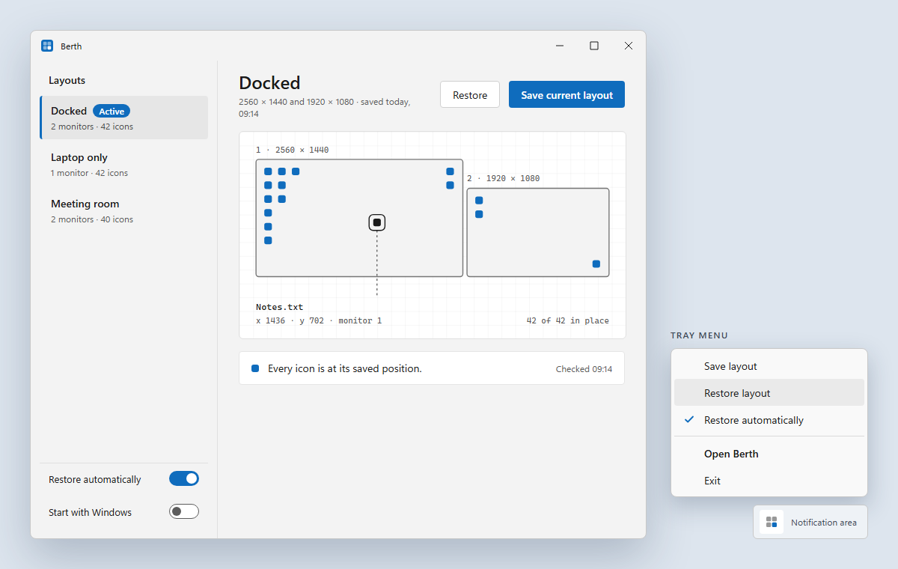
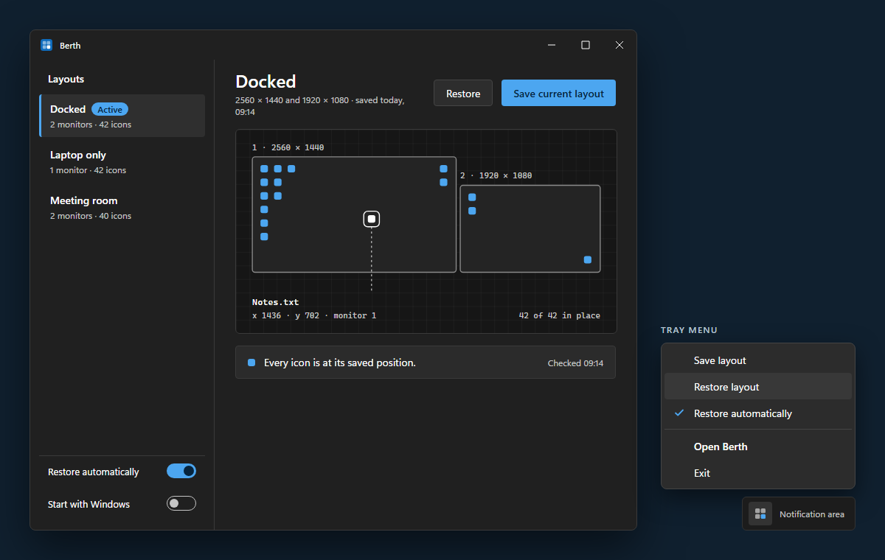

<div align="center">


# Berth

**Your desktop, where you left it. Berth saves the positions of your Windows desktop icons and puts them back.**

[](https://github.com/rizonesoft/Berth/actions/workflows/plan.yml)
[](LICENSE)


[What it does](#what-does-berth-do) · [Status](#what-works-today) · [How it will work](#how-will-i-use-it) · [Design](#what-does-it-look-like) · [Contributing](CONTRIBUTING.md) · [Security](SECURITY.md)



<sub>Design mockup with sample data. The app is not built yet.</sub>

</div>

## What does Berth do?

Windows forgets where your desktop icons were. Change the resolution, dock or undock a laptop, connect over Remote Desktop or restart Explorer, and the layout you arranged is scrambled. A berth is a ship's allotted place: Berth gives every icon one, and returns it there.

- **Saves every icon's position** to a small layout file.
- **Keeps a layout per monitor arrangement**, so a docked setup and a laptop on its own each have their own.
- **Puts icons back** on demand, or automatically when the monitor arrangement changes.
- **Shows you the layout**: a map of each monitor with every saved position, and which icons have moved.
- **One file, no installer**: no administrator rights, no network use, no telemetry.

## What works today?

| Part | State |
| ---- | ----- |
| Brand, design contract and build plan | Done |
| `berth.exe`: tray app, main window and command line | Planned in [`todo/`](todo/implementation-plan.md), not built yet |

There are no releases yet. This page describes what is being built, and it is updated as each part lands.

## How will I use it?

Run `berth.exe`. It sits in the notification area:

- **Left-click** the icon to open the main window, with your saved layouts and the position map.
- **Right-click** for the menu: Save layout, Restore layout, Restore automatically, Open Berth, Exit.

From a terminal or a script, the same work runs as commands and then exits:

```
berth save
berth restore
berth undo
berth list
```

`berth restore` exits with code 3 and a one-line reason when it has to refuse, for example while Windows has "Auto arrange icons" turned on. Every command, message and exit code is listed in [`design/SPEC.md`](design/SPEC.md#13-command-line).

## What does it look like?



Berth follows the Windows theme, light or dark. The icon is a two by two grid of desktop icons on a blue tile, with a dot on the one Berth is holding in place.

| Asset | File |
| --- | --- |
| App icon, 16 to 256 px | `assets/icon/berth.ico` |
| Tray icons for a dark and a light taskbar | `assets/icon/berth-tray-dark.ico`, `assets/icon/berth-tray-light.ico` |
| Icon sources and PNGs (256, 512, 1024 px) | `assets/icon/*.svg`, `assets/icon/berth-icon-*.png` |
| Logo for light and dark backgrounds | `assets/logo/berth-lockup.png`, `assets/logo/berth-lockup-white.png` |
| GitHub social preview, 1280 × 640 | `assets/banner/github-social-preview.png` |
| Social banner, 1500 × 500 | `assets/banner/social-banner.png` |

- **Colour.** Harbour Blue `#0F6CBD` (on light), Day Blue `#4CA6F0` (on dark), Ink `#1A1A1A`, Mica `#F3F3F3`, Card `#FFFFFF`.
- **Type.** Segoe UI Variable throughout, and Cascadia Mono for coordinates and commands.
- **Wordmark.** "Berth" in Segoe UI Variable Display Semibold, to the right of the icon.

`python assets/build.py` rebuilds every `.ico` and `.png` from the sources in `assets/`. It needs Pillow, Microsoft Edge and Segoe UI Variable, so it runs on Windows 11. The icon shapes are defined twice, in `assets/icon/*.svg` and in `build.py`: change both together.

## How is it built?

- **Language and runtime:** C# on .NET 11, for Windows 11 version 24H2 or later, x64.
- **Interface:** WPF with the built-in Fluent theme, and a Windows Forms tray icon.
- **Icon positions:** the documented shell interface `IFolderView`, never Explorer's internal list-view window.
- **Storage:** one JSON file per monitor arrangement under `%APPDATA%\Berth\layouts`.

| Document | What it holds |
| --- | --- |
| [`design/SPEC.md`](design/SPEC.md) | The design contract: every surface, state, message and command |
| [`docs/plans/2026-11-15-berth-foundation.md`](docs/plans/2026-11-15-berth-foundation.md) | The architecture and the milestones |
| [`todo/implementation-plan.md`](todo/implementation-plan.md) | The build plan, generated from the TODO sections |
| [`AGENTS.md`](AGENTS.md) | The working rules for people and agents |

The plan is built section by section, and each section is reviewed by a different model family before it is marked done. `pwsh scripts/start-run.ps1` starts an unattended run of the plan in Claude Code. A run starts only when its operator starts it, and ends when its window closes.

## How do I contribute?

Read [CONTRIBUTING.md](CONTRIBUTING.md). Bugs and ideas go through the [issue forms](https://github.com/rizonesoft/Berth/issues/new/choose), and security problems through [SECURITY.md](SECURITY.md).

## What is the licence?

Berth is free software under the [GNU General Public License, version 3 or later](LICENSE). The [Code of Conduct](CODE_OF_CONDUCT.md) is the Contributor Covenant, used under CC BY 4.0.
